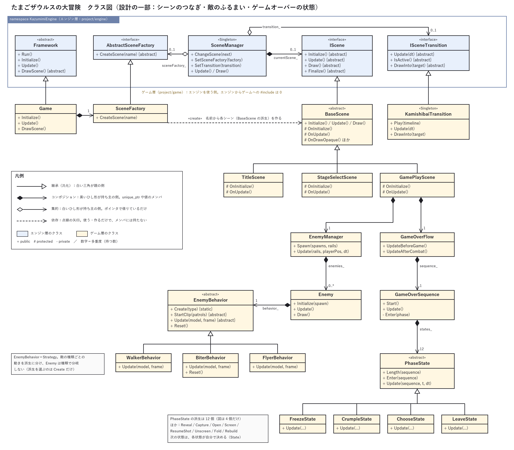
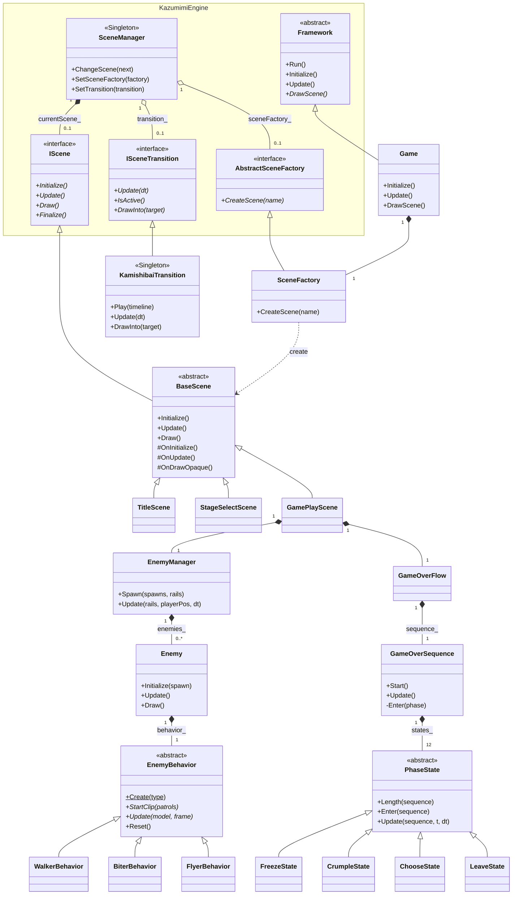

# クラス図（設計の一部）

「たまごザウルスの大冒険」のうち、**エンジンとゲームのつなぎ（シーン）**・**敵のふるまい**・**ゲームオーバー演出の状態**を抜き出した UML クラス図です。

- 画像：[class_diagram.png](class_diagram.png)（`python tools/review/make_class_diagram.py` で描き直せます）
- 下は同じ内容の Mermaid 版です（GitHub の上でそのまま図になります）

## 記号

| 記号 | 意味 | この図での使い分け |
|---|---|---|
| `<|--` 白い三角 | 継承（汎化） | 三角が親の側 |
| `*--` 黒いひし形 | コンポジション | `std::unique_ptr` や値のメンバ。持ち主が消えると一緒に消える |
| `o--` 白いひし形 | 集約 | ポインタで借りているだけ。持ち主は別にいる |
| `..>` 点線の矢印 | 依存 | 使う・作るだけで、メンバには持たない |

## Mermaid

## 読み方

- **依存の向き**：`engine/`（`namespace KazumimiEngine`）は `game/` を知りません。シーンを作る役は、エンジンの `AbstractSceneFactory` をゲームの `SceneFactory` が実装して `SceneManager` に渡します（`SceneManager` は借りているだけなので集約）。
- **Template Method**：`BaseScene` が初期化・更新・描画の流れを持ち、各シーンは `OnInitialize` / `OnUpdate` / `OnDrawOpaque` などの決まった所だけを書きます。
- **Strategy**：`Enemy` は敵の種類で分岐しません。種類ごとの動き（歩く・噛みつく・飛ぶ）は `EnemyBehavior` の派生が持ち、派生を選ぶのは `EnemyBehavior::Create` だけです。
- **State**：`GameOverSequence` の 12 個の段（止まる → くしゃくしゃ → 選ぶ → …）は、それぞれ `PhaseState` の派生クラスです。次の段へ進むかどうかは各状態が決めます。図には 4 個だけ載せています（ほか：`RevealState` / `CaptureState` / `OpenState` / `ScreenState` / `ResumeShotState` / `UnscreenState` / `FoldState` / `RebuildState`）。
