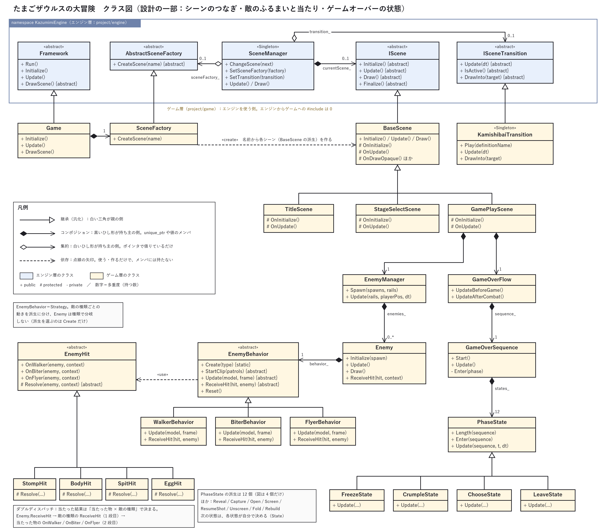

[](https://github.com/yuzurihakazuma/KazumimiEngine/actions/workflows/DebugBuild.yml)
[](https://github.com/yuzurihakazuma/KazumimiEngine/actions/workflows/Release.yml)
[](https://github.com/yuzurihakazuma/KazumimiEngine/actions/workflows/Development.yml)

# たまごザウルスの大冒険

自作エンジン **KazumimiEngine**（DirectX 12 / C++20）で作っている、紙と段ボールの工作の世界を走る 3D アクションゲームです。
恐竜がレールの上を走り、ベロで敵を食べて卵にし、卵を投げてしかけを動かしながらゴールを目指します。

- 開発環境：Visual Studio 2022（v143）／ Windows 11 ／ DirectX 12
- ソリューション：`project/CG2_00_01.sln`（`CG2_00_01` は、授業のビルド設定を保つための内部名です）
- 構成：`Debug`（エディタ付き・デバッグ）／ `Development`（エディタ付き・Release の速さ）／ `Release`（製品版）
- 警告：レベル 4・警告をエラーとして扱う（3 つの構成ともリビルドで 0 warning）

## フォルダ構成

```
project/
  engine/      自作エンジン（ゲームの中身を知らない層。game/ を include しない）
    base/        ウィンドウ・DirectX の土台・入力・時間・Framework
    graphics/    パイプライン・テクスチャ・一括描画（InstancedGroup）
    2d/ 3d/      スプライト・モデル・アニメーション
    math/        ベクトル・行列・補間
    scene/       IScene・ISceneTransition・SceneManager
    utils/       エディタ・マップの読み書き・JSON・Signal・StepSequence
  game/        ゲーム（たまごザウルスの大冒険）
    scene/       タイトル・ステージ選択・本編（BaseScene を継承）
    player/      恐竜（入力・ジャンプ・向き・ブロックとの当たり・ベロ・卵投げ）
    enemy/ egg/  敵・卵とコンボ
    rail/        レール（つなぎ方・動くレール・列車・道のメッシュ）
    stage/       ブロック・コイン・背景・ステージ開始の演出・記録
    clear/ gameover/ transition/   クリア演出・ゲームオーバー・紙芝居の画面遷移
    worldmap/ title/ ui/ effect/   ステージ選択の箱庭・タイトル・HUD・紙吹雪
    editor/      ゲーム画面の上で使うエディタ（配置ビュー・背景エディタなど）
  resources/   モデル・画像・音・マップ（JSON）・調整値（JSON）
tools/         素材を作るスクリプト（Blender / Python）と、描画なしで動かす確かめ用の道具
docs/          エディタの使い方・クラス図
```

## 設計で意識していること

| 考え方 | 使っている所 |
|---|---|
| 依存の向き | `engine/` は `game/` を知らない（エンジンからゲームへの `#include` は 0）。シーンの生成は `AbstractSceneFactory`（エンジン）を `SceneFactory`（ゲーム）が実装して渡す |
| namespace | エンジン層は全部 `namespace KazumimiEngine` の中。ゲームのヘッダは `KazumimiEngine::Vector3` のように名前を付けて書き、`using namespace` は `.cpp` だけ |
| Template Method | `Framework`（初期化・更新・描画の流れ）を `Game` が継承。`BaseScene` が共通の流れを持ち、各シーンは `OnDrawOpaque` などの決まった所だけを書く |
| Factory Method | `AbstractSceneFactory` → `SceneFactory`（シーンの名前から実体を作る） |
| ポリモーフィズム | 種類で分かれる所は、基底クラスの仮想関数を派生が上書きし、持ち主は基底のポインタ・参照で呼ぶ（種類を見て分岐しない）。紙芝居遷移の部品 17 種（`PartAction`）・ノードエディタのノード 25 種（`NodeKind`）・背景エディタの道具 5 種と地面の塗り方（`ToolMode`・`GroundBrush`）・配置ビューの道具（`IStripTool`）・動くレールの動き方（`MotionPath`）・レールの形（`RailShape`）・卵コンボの的（`TargetStyle`）・タイトルの草木のゆれ方（`SwayStyle`）。値が違うだけの所（色・名前・設定値）は、クラスではなく表にしている |
| Strategy | 敵の種類ごとの動き `EnemyBehavior` → `WalkerBehavior`・`BiterBehavior`・`FlyerBehavior`（`Enemy` は種類で分岐しない）。画面遷移 `ISceneTransition` → `KamishibaiTransition`（`SceneManager` は遷移の中身を知らない） |
| State | 状態が 4 つ以上ある所は、状態ごとのクラスにしている（持ち主は今の状態の仮想関数を呼ぶだけで、次の状態へ進むかは各状態が決める）。ゲームオーバー演出 12 段（`GameOverSequence::PhaseState`）・タイトル 9 段（`TitleScene::PhaseState`）・ステージ選択 5 段（`StageSelectScene::PhaseState`）・ステージ開始の演技（`StageIntroSequence` の `ActState`・`DropState`・`RollState`）・リザルト画面・ゲームオーバー画面・落下ミスのアイリス・卵コンボの的・撮影のテイク。状態が 3 つ以下の所（列車・卵・ベロなど）は enum のまま |
| State（場面の列） | `StepSequence<TContext>` と `IStep`。クリア演出は `GateStep` → `GoalStep` → `CurtainStep` を順に実行し、場面クラス自身が終わりを決める |
| Observer | `Signal<Args...>`。出す側は、だれが聞いているかを知らない。敵を倒した・コンボが変わった・ダメージを受けた（集計と HUD へ）、壁にぶつかった・ジャンプ台で跳ねた（`Player` → 見た目と音）、？ブロックからコインが出た（`BlockSystem`）、飛び込みで跳んだ・着いた（`DiveSequence`）、ロゴが刺さった・ベロが届いた（タイトル） |
| Command | 背景エディタの元に戻す・やり直す（`BackdropHistory`）。操作 1 回ぶんを `BackdropCommand`（`Execute`・`Undo`）にして積む。物の数が変わらない操作は「変わった物だけ」を覚える |
| Double Dispatch | 敵に何かが当たった時の結果を「当たった物の種類 × 敵の種類」で決める。`Enemy::ReceiveHit` → `EnemyBehavior::ReceiveHit`（敵の種類）→ `EnemyHit::OnWalker` / `OnBiter` / `OnFlyer`（踏みつけ・体当たり・卵・敵ボール）。`CombatSystem` は当たったかどうかを調べるだけ |
| Memento | レールエディタの元に戻す・やり直し（`RailEditor::RailSnapshot`） |
| Builder | `GraphicsPipelineBuilder`・`RootSignatureBuilder` |
| Object Pool | 見た目（`Obj3d`）を捨てずに返して使い回す：卵・吐き出す敵ボール・けむりの粒・殻の欠片（`EggSystem` の見た目のプール）、ブロックの行列計算用（`BlockRenderer`）、踏みつけの輪（`CombatSystem`）、コンボの代役（`EggCombo`）、敵の実体（`EnemyManager`）。実行中には作らない |
| Dirty Flag | 変わった時だけ作り直す：レールの距離の表（`SplineRail`。形を変えると印が付き、`RebuildIfDirty` は印のあるレールだけ作り直す）、背景の一括描画の組み分け（`StageBackdrop`）、スプライトと SDF の文字の頂点 |
| Singleton | `Singleton<T>`（CRTP）に 1 つにまとめ、マネージャだけで使う |
| カプセル化 | メンバ変数は全部 private（public・protected は 0）。中の物を非 const の参照・ポインタで返す関数も置かない。`SplineRail` は読む入口（`Config()` など、どれも const）と、項目ごとの書き換え（`SetVisible()` など）に分けている。ImGui の調整は「写しを直して `Set〜` で戻す」形。`tools/review/audit_encapsulation.py` で数えられる |
| データ駆動 | マップ・敵とコインの配置・背景・列車・カメラ・クリア演出の秒数と置き場所は JSON。敵の種類ごとの値は表（`Enemy.cpp` の `kTypeTable`） |

クラス図（シーンのつなぎ・敵のふるまい・ゲームオーバーの状態）は [docs/class_diagram.md](docs/class_diagram.md) にあります。



## 確かめ方

- `tools/railsim`・`tools/blocksim`：ゲーム本体と同じ `Player`・レール・ブロックのコードを、描画なしでビルドして動かします（乗り移り・当たり・列車の乗り降りを、起動せずに確かめられます）
- `tools/review/audit.py`：クラスコメント・値渡しの引数・include の書き方などを数えます
- `tools/review/audit_encapsulation.py`：public / protected のメンバ変数・中身を参照で返す関数・friend・グローバル変数を数えます（今は全部 0。friend は `StepSequence` の内側だけ）
- `tools/review/make_class_diagram.py`：クラス図（`docs/class_diagram.png`）を描き直します
- GitHub Actions：3 つの構成のビルドと、不要なファイルが入っていないかの確認

エディタの使い方は [docs/エディタの使い方.md](docs/エディタの使い方.md) にあります。
